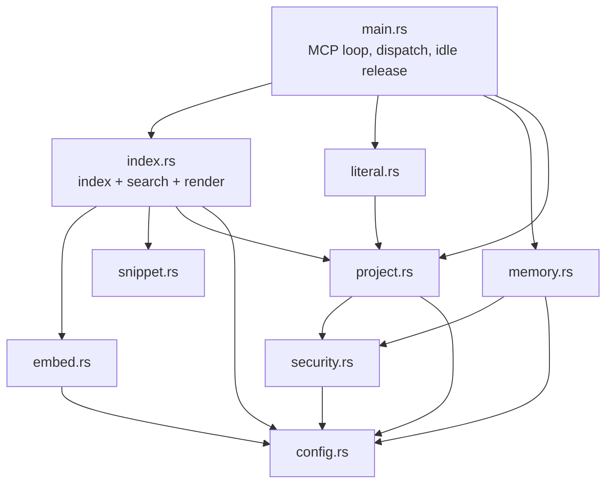
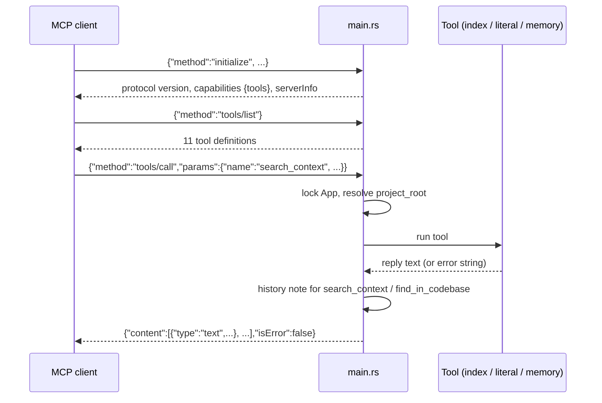
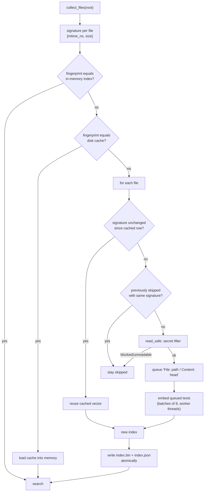
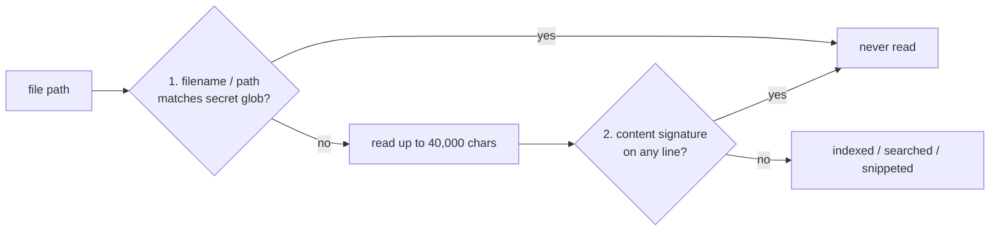
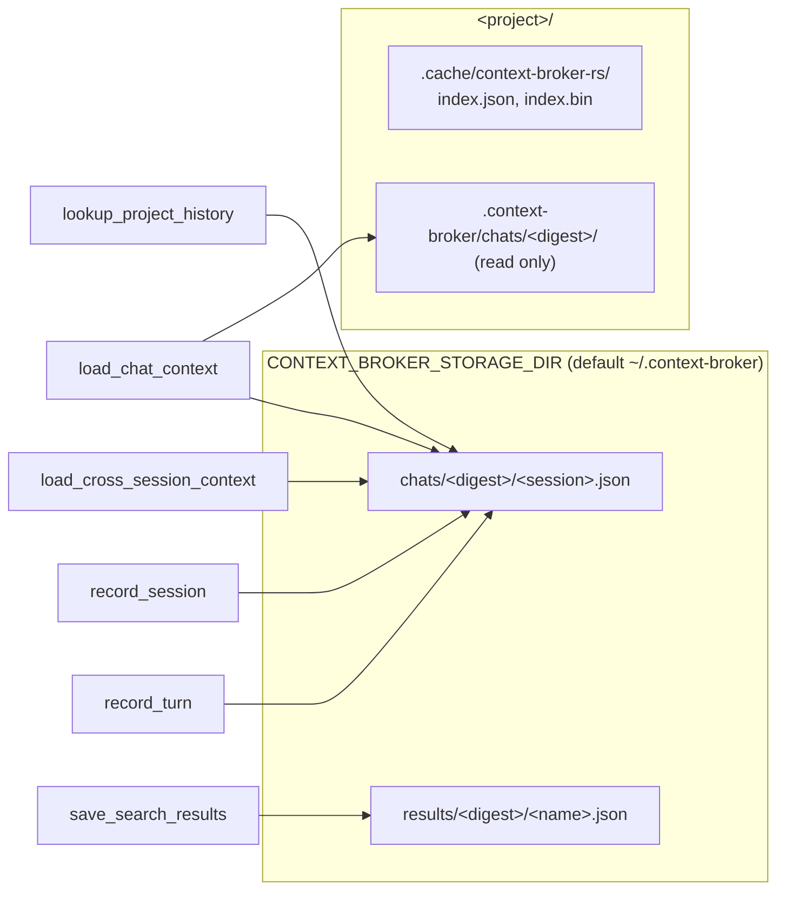

# Architecture

Context Broker (Rust) is a single-process MCP server over stdio. This document describes how it is put together. Every statement refers to the code in `src/`.

## Module map

| Module | Responsibility |
|--------|----------------|
| `main.rs` | The MCP loop (hand-written JSON-RPC 2.0, one message per line), the 11 tool definitions, dispatch, the idle-release thread |
| `config.rs` | Environment settings and the fixed policy tables (secret patterns, ignored directories, extensions, project markers, size limits) |
| `security.rs` | Secret detection: filename globs and content signatures |
| `project.rs` | Project root resolution, file collection (ignore-aware), safe file reads |
| `embed.rs` | `all-MiniLM-L6-v2` on `candle`: model lookup/download, tokenization, batch-parallel embedding |
| `index.rs` | The incremental index, its disk cache, cosine-similarity search and reply rendering |
| `snippet.rs` | Query-focused line selection within a token budget |
| `literal.rs` | Literal and regex search over the safe file set |
| `memory.rs` | Chat ledger, history lookup, saved search results |

## Request flow

The process reads stdin line by line. Each line is one JSON-RPC message. A line that is not valid JSON gets a `-32700` error with `id: null`. A message without an `id` is a notification and is never answered. Output is one JSON line per request, flushed immediately; if writing fails (the client went away) the loop ends and the process exits. Closing stdin ends it the same way.

- `initialize` echoes the requested protocol version when it is one of `2025-11-25`, `2025-06-18`, `2025-03-26`, `2024-11-05`, and otherwise answers `2025-06-18`.
- `ping` returns `{}`; unknown methods return `-32601`.
- `tools/call` takes the `App` mutex, runs the tool and records the time of use (for idle release). A tool error is returned as a normal result with `isError: true` and the text `Error: <message>`.
- The reply is a list of text content blocks. Normally there is one; `search_context` and `find_in_codebase` append a second block with a short "related past work" note when the project's chat history strongly matches the question. There is no `structuredContent`.
- Progress and diagnostics go to stderr, never stdout.

## Indexing pipeline

The index holds one embedding per file. It is refreshed at the start of every search.

1. **Collect.** `project::collect_files` walks the root with the `ignore` crate: `.gitignore` and `.ignore` are honored, hidden files are visited, symlinks are not followed, ignored directory names (`node_modules`, `target`, `.git`, `.cache`, `.context-broker`, ...) are pruned, and only supported extensions under the size limit and without a secret-looking name are kept. The result is sorted.
2. **Signature and fingerprint.** Each file gets `[mtime_ns, size]`. A SHA-256 over all paths and signatures is the index fingerprint. An identical fingerprint means nothing changed: no file is read.
3. **Reuse or embed.** When the fingerprint differs, rows whose signature is unchanged are copied from the previous index (memory first, then disk). New or changed files are read with `read_safe` (at most 40,000 characters, secret filter applied). The first 3,000 characters become the text `File: <path>\nContent: <head>`. Files that are unreadable or secret-bearing are recorded in a `skipped` map and are not retried until their signature changes.
4. **Embed.** Queued texts are split into batches of 8 and processed by up to `CONTEXT_BROKER_EMBED_THREADS` worker threads that pull batches from a shared counter. Each batch is tokenized (max 256 tokens, padded), run through the BERT model, mean-pooled over real tokens and L2 normalized.
5. **Persist.** Vectors are stored as little-endian `f32` in `index.bin`; paths, signatures, skipped files, model name, dimension, cache version and fingerprint in `index.json`. Both live in `<project>/.cache/context-broker-rs/` and are written to a temporary file and renamed. A cache with a different version, model or size is ignored.

## Search and snippet selection

1. The query is embedded with the same model. Every index row is scored by dot product (vectors are normalized, so this is cosine similarity), sorted descending, and the top `top_k` (1 to 20) rows are taken.
2. For each, the file is re-read through `read_safe` (a file that has become secret-bearing yields no hit) and `snippet::focused` selects lines:
   - query terms are lower-cased words of at least 3 characters, minus a small stopword list, at most 16;
   - a term that is rare in the file weighs more than one on every line (weight is `1 / lines containing it`);
   - lines that look like definitions (`fn`, `def`, `class`, `struct`, ...) score double;
   - best lines are taken first, each with `CONTEXT_BROKER_RESULT_SNIPPET_CONTEXT_LINES` neighbours, until `CONTEXT_BROKER_RESULT_MAX_TOKENS_PER_FILE` (estimated at about 3.7 characters per token) is spent;
   - gaps in the selection are marked with `@L<line>`; a file with no query term falls back to its head.
3. `index::render` prints `<shown> of <indexed> files · root: <root>` once, then `### <relative path>` and the snippet for each hit.

`find_in_codebase` is separate: it escapes the pattern unless `use_regex` is set, compiles it with the `regex` crate (linear time, 1 MiB size limit), and scans the same collected files through `read_safe`.

## Security layers

Policy tables are constants in `config.rs`; no setting can relax them.

1. **Path layer.** `security::is_secret_path` matches the file name and the relative path against 35 globs (`.env`, `.env.*`, `*.pem`, `*.key`, `id_rsa`, `.aws/credentials`, `*.tfstate`, `secrets.*`, `*.token`, ...). It runs during collection and again inside every read.
2. **Content layer.** `security::has_secret_content` scans the lines that were read. Comment lines starting with `#` are ignored. A line is a hit if it contains a value signature (private key headers, `_authToken`, `_auth`, `Bearer `) or starts with an assignment (`KEY=` or `key:`, optional `export` and quotes) whose name contains a key signature such as `API_KEY`, `PASSWORD`, `SECRET`, `TOKEN` or `KEY`. The assignment anchor keeps ordinary code such as `token = make_token()` indexable.
3. **Memory layer.** `memory::record` refuses messages with secret content (nothing is saved), and history lookups skip exchanges that have it.

All file reads go through `project::read_safe`, so indexing, snippets and literal search share the same rules. Walking never follows symlinks.

## Memory and storage layout

- **Digest.** The first 16 hex characters of the SHA-256 of the canonical project root path.
- **Chat ledger.** One JSON file per session: `{project: {digest, name, root}, session_id, messages: [{peer_id, content, created_at}], updated_at}`. Writes are append-only: read, extend, write to a temporary file, rename. A `.lock` file (created exclusively, stale after 10 s) serializes writers across processes. Session ids are reduced to `[alphanumeric - _ .]`; a lossy reduction appends a short digest so ids never collide.
- **History.** Lookups read the 128 most recently modified ledgers (each up to 1 MB) from the global store and from `<project>/.context-broker/chats/<digest>/`. `lookup_project_history` and the automatic note use term overlap: at least 2 shared terms and at least 60% of the query's terms; an exchange is a question plus the assistant message that follows it when both fit in 2,000 characters.
- **Saved results.** `<storage>/results/<digest>/<name>.json` with `{project_root, query, saved_at, results}`.

## Threading and idle release

- **Main thread** reads stdin and answers requests one at a time. All engine state (the model, the per-project indexes) sits behind one `Mutex<App>`.
- **Embedding workers.** Only during bulk embedding: up to `CONTEXT_BROKER_EMBED_THREADS` scoped threads, each pulling whole batches. Parallelism is across batches, so `RAYON_NUM_THREADS` is set to 1 at startup (unless already set) to stop the matrix library from oversubscribing the machine.
- **Idle thread.** Wakes every `min(timeout, 30)` seconds. If no tool call has happened for `CONTEXT_BROKER_IDLE_RESOURCE_TIMEOUT_SECONDS` (default 900; 0 disables the thread) and the lock is free, it drops the model and all in-memory indexes and, on glibc Linux, calls `malloc_trim`. The next search reloads the index from the disk cache, which is cheap. Large embedding runs also trigger `malloc_trim` when they finish.
- **Model loading** is lazy: the first call that needs an embedding loads it (memory-mapped weights), which is why startup is a couple of milliseconds.

## Differences from the Python architecture

| | Python Context Broker | This port |
|---|---|---|
| Runtime | Python 3.13, FastMCP, PyTorch, scikit-learn | Rust, `candle`, hand-written JSON-RPC |
| Tool surface | 36 tools, router, handoffs, delegation, generators | 11 tools: search, memory, saved results |
| Transports | stdio, SSE, streamable HTTP, shared service | stdio only |
| Embedding | sentence-transformers (in a worker process) | the same weights, in process via `candle` |
| Index | cached JSON | `index.json` + raw `f32` `index.bin` |
| Cross-chat memory | Honcho or Redis backends, dashboard | local JSON ledger only |
| Replies | JSON/text with reports | plain text blocks, root stated once, no telemetry |
| Shared layout | ledgers under `<storage>/chats/<digest>/` | same layout and schema |

Not ported: Honcho and Redis backends, the web dashboard, task delegation, model handoffs, the AGENTS.md / changelog / feature-docs generators, the environment doctor, the plan-execution tools, and the SSE / HTTP transports.
