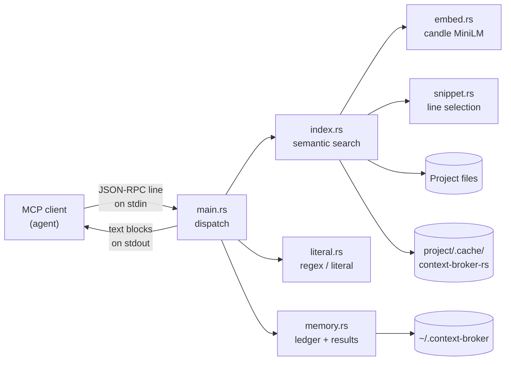

<div align="center">

# 🦀 Context Broker (Rust)

**Semantic code search and project memory for AI coding agents, in one 8 MB binary.**

A Rust port of the core of [Context Broker](https://github.com/InSelfControll/context-broker-mcp). It speaks the Model Context Protocol over stdio, finds relevant code by meaning, remembers decisions across sessions, and keeps every reply small: 11 tools, plain-text answers, no telemetry. 100% local, no API keys, no Python, no PyTorch.

[](Cargo.toml)
[](LICENSE)
[](https://modelcontextprotocol.io)
[](#-quick-start)


**Works with:** Claude Code · Claude Desktop · Cursor · Codex CLI · any MCP client that can launch a stdio server

[🚀 Quick Start](#-quick-start) · [✨ Features](#-features) · [🧰 Tools](#-the-11-tools) · [📊 Performance](#-performance) · [⚙️ Settings](#%EF%B8%8F-settings) · [🏗️ Architecture](ARCHITECTURE.md)

</div>

---

## 🎯 Why a Rust port?

Every MCP tool you register costs tokens in every session, before the agent has done anything: the tool list is sent with each conversation. The Python Context Broker is already token-optimized, but it exposes 36 tools, needs a Python environment with PyTorch, and takes seconds to wake up. This port keeps the part agents use most (semantic search, literal search, chat memory, saved results) and makes it small and fast.

| | Python Context Broker | This port |
|---|---|---|
| Tool list each session pays for | 36 tools, 3,986 tokens | **11 tools, 1,067 tokens** |
| Average search reply (6 queries) | ~900 tokens | **~660 tokens** |
| Startup | 0.8 s | **2 ms** |
| Install | Python env + PyTorch | **one 8 MB binary** |
| Embedding model | `all-MiniLM-L6-v2` | the same weights, run with `candle` |

Numbers were measured on a 235-file repository against the already-optimized Python server; the [full table](#-performance) is below.

---

## ✨ Features

<table>
<tr>
<td width="50%">

### 🔍 Semantic Code Search
Describe what you need in plain English. Files are embedded with `all-MiniLM-L6-v2` (mean pooling, L2 normalized) and ranked by cosine similarity. The reply carries only the best-matching lines of the top files, with `@L<line>` markers where lines were skipped.

### 🎯 Exact Search
`find_in_codebase` does literal or regex search over the same safe file set, with a linear-time regex engine, so a bad pattern cannot hang the server.

### 💸 Lean Replies
Plain text, sent once, with the project root stated a single time and relative paths. No output schemas and no per-request telemetry.

</td>
<td width="50%">

### 🧠 Project Memory
`record_turn` and `record_session` append to a local JSON chat ledger. `load_chat_context`, `load_cross_session_context` and `lookup_project_history` read it back. Search replies add a short "related past work" note when the history strongly matches the query.

### 🔐 Secrets Never Leave
Hard-coded filename patterns (`.env`, keys, credentials, ...) and content signatures (`API_KEY=`, `Bearer `, private key headers, ...) keep a file out of indexing, search and snippets. Messages that contain secrets are not recorded.

### ⚡ Incremental and Cached
Only files whose modification time or size changed are re-embedded. The index lives in `<project>/.cache/context-broker-rs/`, so a new process loads it instead of rebuilding.

</td>
</tr>
</table>

**Plus:** 🧵 batch-parallel embedding on a few worker threads · 💤 model and in-memory indexes released after 15 idle minutes · 🪦 exits when the client closes stdin · 🚫 honors `.gitignore` and `.ignore`, never follows symlinks · 📦 a single binary, no runtime library to install.

---

## 🚀 Quick Start

**Option 1: prebuilt static binary (Linux, no dependencies).** Each [release](https://github.com/InSelfControll/context-broker-rs/releases) carries a fully static (musl) binary for `x86_64` and `aarch64` that runs on any Linux distribution, with no libc or other library required:

```bash
curl -L https://github.com/InSelfControll/context-broker-rs/releases/latest/download/context-broker-x86_64-unknown-linux-musl.tar.gz | tar xz
sudo install -m 755 context-broker /usr/local/bin/context-broker
```

Use `aarch64-unknown-linux-musl` in the file name on ARM. A `.sha256` file is published next to each archive.

**Option 2: build from source.** Needs a recent stable Rust (developed on 1.100; the 1.92 shipped by some distributions is too old for a dependency, so use the prebuilt binary there).

```bash
git clone https://github.com/InSelfControll/context-broker-rs.git
cd context-broker-rs
cargo build --release
```

The binary is `target/release/context-broker` (or wherever you installed the prebuilt one). It reads one JSON-RPC message per line on stdin and answers on stdout, so there is nothing to start by hand; your MCP client launches it. The command is just the binary path, with no arguments.

**Claude Code**

```bash
claude mcp add context-broker-rs -- /absolute/path/to/context-broker-rs/target/release/context-broker
```

**Codex CLI** (`~/.codex/config.toml`)

```toml
[mcp_servers.context-broker-rs]
command = "/absolute/path/to/context-broker-rs/target/release/context-broker"
```

<details>
<summary><b>Manual JSON configuration</b> (Claude Desktop, Cursor, and other clients that use <code>mcpServers</code>)</summary>

```json
{
  "mcpServers": {
    "context-broker-rs": {
      "command": "/absolute/path/to/context-broker-rs/target/release/context-broker"
    }
  }
}
```

To pin one project instead of auto-detecting it, add an environment variable:

```json
{
  "mcpServers": {
    "context-broker-rs": {
      "command": "/absolute/path/to/context-broker-rs/target/release/context-broker",
      "env": { "CONTEXT_BROKER_PROJECT_ROOT": "/path/to/project" }
    }
  }
}
```

</details>

<details>
<summary><b>The embedding model</b> (where the weights come from)</summary>

The model is `sentence-transformers/all-MiniLM-L6-v2` (`config.json`, `tokenizer.json`, `model.safetensors`). It is looked up in this order:

1. `CONTEXT_BROKER_MODEL_DIR`, a directory that already holds the three files.
2. An existing Hugging Face cache (`$HF_HOME/hub`, default `~/.cache/huggingface/hub`).
3. The broker's own cache, `~/.cache/context-broker/models/all-MiniLM-L6-v2` (override the base with `CONTEXT_BROKER_MODEL_CACHE_DIR`). If the files are missing they are downloaded once from `huggingface.co`, written to a `.part` file and renamed when complete.

If the Hugging Face cache already holds the model (for example from the Python broker), nothing is downloaded.

</details>

### Verify it works

Pipe two messages into the binary:

```bash
printf '%s\n' \
  '{"jsonrpc":"2.0","id":1,"method":"initialize","params":{"protocolVersion":"2025-06-18"}}' \
  '{"jsonrpc":"2.0","id":2,"method":"tools/call","params":{"name":"search_context","arguments":{"query":"where is the main entry point","project_root":"/path/to/project"}}}' \
  | ./target/release/context-broker
```

The second line of output is a JSON-RPC result whose `content` holds the plain-text reply. Progress messages go to stderr, never to stdout.

---

## 📊 Performance

Measured on a 235-file repository, against the already-optimized Python server.

| | Python | Rust |
|---|---|---|
| Tool list each session pays for | 36 tools, 3,986 tokens | 11 tools, 1,067 tokens |
| Average search reply (6 queries) | ~900 tokens | ~660 tokens |
| Startup | 0.8 s | 2 ms |
| First search in a new process (index cached) | ~8 s | 78 ms |
| Warm search | 130-200 ms | 12-20 ms |
| Search after editing one file | 210 ms | 163 ms |
| Memory with model loaded | ~135 MB + ~890 MB worker | ~103 MB (about 200 MB after a full index) |
| Install | Python env + PyTorch | one 8 MB binary |

> **Honest limitation:** the first full index of a project is slow. It took about 12 s for 235 files on 4 worker threads, roughly 0.18 s of CPU per file. Afterwards only changed files are re-embedded and the index is cached on disk, so you pay this once per project (and again only for files you edit).

---

## 🧰 The 11 Tools

| Tool | Purpose |
|------|---------|
| [`search_context`](docs/tools/search_context.md) | Semantic search; best-matching lines of the top files. No query gives a project overview. |
| [`find_in_codebase`](docs/tools/find_in_codebase.md) | Exact literal or regex search; file, line and snippet. |
| [`route_task`](docs/tools/route_task.md) | Suggest which of these tools fit a task. |
| [`record_turn`](docs/tools/record_turn.md) | Append one user/assistant exchange to a session. |
| [`record_session`](docs/tools/record_session.md) | Append a whole conversation to a session. |
| [`load_chat_context`](docs/tools/load_chat_context.md) | Load one stored session, newest messages last. |
| [`load_cross_session_context`](docs/tools/load_cross_session_context.md) | Find stored messages across all sessions of the project. |
| [`lookup_project_history`](docs/tools/lookup_project_history.md) | Up to three past exchanges that match an issue. |
| [`save_search_results`](docs/tools/save_search_results.md) | Run a semantic search and save the reply under a name. |
| [`list_saved_results`](docs/tools/list_saved_results.md) | List saved search results. |
| [`load_saved_results`](docs/tools/load_saved_results.md) | Load a saved search result. |

See [docs/TOOLS.md](docs/TOOLS.md) for parameters and example replies.

---

## 🏗️ How It Works



1. **Collect.** Walk the project honoring ignore files; drop ignored directories, unsupported extensions, oversized files and secret-named files.
2. **Fingerprint.** Compare each file's modification time and size with the cached index. Unchanged rows are reused.
3. **Embed.** Changed files are read through the secret filter and embedded in batches across worker threads.
4. **Search.** The query is embedded, scored against every row, and the top files get a query-focused snippet within a token budget.

The details, including diagrams for the request flow and the storage layout, are in [ARCHITECTURE.md](ARCHITECTURE.md).

---

## ⚙️ Settings

All settings are environment variables. Names are shared with the Python broker where the feature exists in both.

| Variable | Default | Meaning |
|----------|---------|---------|
| `CONTEXT_BROKER_PROJECT_ROOT` | auto-detect | Project used when a call omits `project_root` |
| `CONTEXT_BROKER_RESULT_MAX_TOKENS_PER_FILE` | `240` | Snippet budget per file |
| `CONTEXT_BROKER_RESULT_SNIPPET_CONTEXT_LINES` | `2` | Context lines around a matching line |
| `CONTEXT_BROKER_EMBED_THREADS` | `min(4, cores/2)`, at least 1 | Worker threads for bulk embedding |
| `CONTEXT_BROKER_IDLE_RESOURCE_TIMEOUT_SECONDS` | `900` | Idle time before the model and indexes are released (`0` disables) |
| `CONTEXT_BROKER_INDEX_MAX_FILE_BYTES` | `2000000` | Skip larger files (`0` disables the limit) |
| `CONTEXT_BROKER_STORAGE_DIR` | `~/.context-broker` | Chat ledgers and saved results |
| `CONTEXT_BROKER_MODEL_DIR` | none | Directory with `config.json`, `tokenizer.json`, `model.safetensors` |
| `CONTEXT_BROKER_MODEL_CACHE_DIR` | `~/.cache/context-broker/models` | Where the model is downloaded once |
| `HF_HOME` | `~/.cache/huggingface` | Hugging Face cache searched before downloading |

<details>
<summary><b>Fixed limits</b> (constants, not settings)</summary>

| Limit | Value |
|-------|-------|
| Characters read per file for secret scan and snippets | 40,000 |
| Characters of each file that are embedded | 3,000 |
| Model input length | 256 tokens |
| Texts per inference batch | 8 |
| Indexed extensions | `md json toml yaml yml xml properties gradle go py ts js rs java nix html css scss sass less sh bash zsh fish ps1 sql graphql prisma` |

</details>

---

## 🔒 Privacy and Security

- **Local only.** The only network access is the one-time model download; nothing is sent anywhere afterwards.
- **Hard-coded secret rules.** `SECRET_FILE_PATTERNS`, `SECRET_KEY_SIGNATURES` and `SECRET_VALUE_SIGNATURES` live in `src/config.rs` and cannot be overridden by configuration or `.gitignore`.
- **Checked on every read.** The filename check and the content check run when files are collected, indexed, searched and snippeted, so a file that becomes secret-bearing later is dropped at the next change.
- **Memory is filtered too.** `record_turn` and `record_session` refuse a message containing secret signatures, and history lookups skip exchanges that contain them.

---

## 🙅 Not Ported From the Python Broker

Honcho and Redis backends, the web dashboard, task delegation to worker models, model handoffs, the AGENTS.md / changelog / feature-docs generators, the environment doctor, the plan-execution tools, and the SSE / HTTP transports. If you need those, use the [Python Context Broker](https://github.com/InSelfControll/context-broker-mcp). Chat ledgers use the same layout (`<storage>/chats/<project digest>/<session>.json`), so history written by either server stays readable by the other.

---

## 📖 Documentation

| Document | What is in it |
|----------|---------------|
| [ARCHITECTURE.md](ARCHITECTURE.md) | Module map, request flow, indexing pipeline, security layers, storage layout, threading |
| [docs/TOOLS.md](docs/TOOLS.md) | Index of the 11 tools |
| [docs/tools/](docs/tools/) | One page per tool with parameters and an example reply |
| [docs/assets/make_gif.py](docs/assets/make_gif.py) | Generator for the demo GIF |

## 🧪 Development

```bash
cargo build --release
cargo test --release
```

One end-to-end test drives the real binary over MCP stdio through every tool, the secret and ignore policies, incremental indexing and persistence across a restart. It needs the embedding model (found in the Hugging Face cache, or downloaded once).

Static binaries are built by the `Static binaries` GitHub Actions workflow (`.github/workflows/release.yml`): run it manually for artifacts, or push a `v*` tag to publish a release. To build one yourself: `rustup target add x86_64-unknown-linux-musl`, install a musl C compiler (`musl-tools` on Debian/Ubuntu), then `cargo build --release --target x86_64-unknown-linux-musl`.

To rebuild the demo GIF: `uv run --with pillow python docs/assets/make_gif.py`.

## License

[MIT](LICENSE) © 2026 Ofir (InSelfControll)
