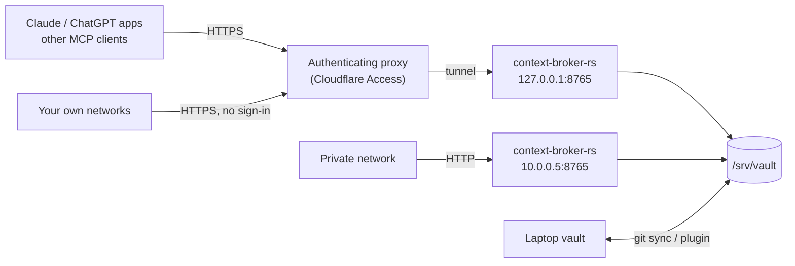

# Remote setup: serving a vault or project to AI apps

By default the broker runs next to your agent and speaks MCP over stdio. This guide covers the
other way to run it: on a server, over HTTPS, so that apps which connect from the internet
(the Claude and ChatGPT apps on web, desktop and phone, or any MCP client on another machine)
can search, read and remember in one folder, such as an Obsidian vault.

All names and addresses below are examples: `vault.example.com`, `you@example.com`,
`203.0.113.10`, `myteam`. Replace them with your own.



## The rule that matters

The broker has **no sign-in of its own**. Whoever can reach its HTTP port can read the folder and,
with sync enabled, change it. So:

1. Bind it to `127.0.0.1` (and, if you need it, a private-network address). Never a public one.
2. Put something in front that authenticates callers.
3. Tell the broker how to recognise an authenticated caller, so a mistake in the proxy does not
   leave the folder open.

## 1. Run the broker on the server

Install the static binary from the [releases page](https://github.com/InSelfControll/context-broker-rs/releases)
and run it as a service:

```ini
# /etc/systemd/system/context-broker.service
[Unit]
Description=Context Broker MCP server (localhost only)
After=network-online.target

[Service]
Environment=CONTEXT_BROKER_HTTP_ADDR=127.0.0.1:8765
Environment=CONTEXT_BROKER_PROJECT_ROOT=/srv/vault
Environment=CONTEXT_BROKER_OBSIDIAN_VAULT=/srv/vault
Environment=CONTEXT_BROKER_STORAGE_DIR=/var/lib/context-broker
Environment=HOME=/var/lib/context-broker
StateDirectory=context-broker
ExecStart=/usr/local/bin/context-broker-rs
Restart=on-failure
NoNewPrivileges=true
PrivateTmp=true
ProtectSystem=strict
ProtectHome=true
ReadWritePaths=/srv/vault

[Install]
WantedBy=multi-user.target
```

- `CONTEXT_BROKER_PROJECT_ROOT` is required in HTTP mode. Every call is confined to it; a
  `project_root` argument pointing elsewhere, or at a hidden folder inside it (`.git`, `.ssh`,
  `.context-broker`), is refused, and `export_memory` with `all_projects` is not available.
- `CONTEXT_BROKER_OBSIDIAN_VAULT` makes memory tools write notes into the vault. Leave it out to
  keep memory in the JSON store.
- The first search downloads the embedding model once and indexes the folder. On a small server a
  vault of a few thousand notes takes several minutes; later searches use the saved index.

Check it locally:

```bash
curl -s -X POST http://127.0.0.1:8765/mcp -H 'content-type: application/json' \
  --data '{"jsonrpc":"2.0","id":1,"method":"initialize","params":{"protocolVersion":"2025-06-18"}}'
```

## 2. Decide who gets in

A caller is accepted when **either** of these holds. With neither configured, every caller that
can reach the port is accepted, which is only acceptable on localhost: the broker refuses to start
on any other address in that case, unless you set `CONTEXT_BROKER_HTTP_ALLOW_OPEN=1`.

| Setting | Accepts |
|---|---|
| `CONTEXT_BROKER_HTTP_ALLOW_IPS=203.0.113.10,2001:db8:1::/56,10.0.0.0/24` | Callers from these addresses or ranges |
| `CONTEXT_BROKER_ACCESS_TEAM_DOMAIN=myteam.cloudflareaccess.com` and `CONTEXT_BROKER_ACCESS_AUD=<application audience tag>` | Callers Cloudflare Access has signed in |

How the caller's address is determined: it is the address of the connection itself. Only when the
connection comes from a proxy on the same machine (a Cloudflare tunnel) is the `CF-Connecting-IP`
header believed instead. A caller connecting directly cannot claim another address by sending that
header. The Access token (`Cf-Access-Jwt-Assertion`) is likewise only read from the local proxy,
and is verified: signature against the team's public keys, audience, issuer and expiry.

### Browsers on the same machine

A web page you visit can send requests to `127.0.0.1`, and a site can point its own domain at your
machine (DNS rebinding). So the broker also checks two headers browsers always send:

- `Host` must be an address, `localhost`, or a name listed in `CONTEXT_BROKER_HTTP_ALLOW_HOSTS`
  (comma separated, no port). Requests carrying a valid Access token skip this check. **If you
  publish through a tunnel and let callers in by address only (no Access), list the tunnel's
  public hostname here**, for example `CONTEXT_BROKER_HTTP_ALLOW_HOSTS=vault.example.com`, or set
  `httpHostHeader: localhost` on the tunnel's ingress rule.
- `Origin`, when present, must be a local page, the Obsidian app, or a listed host. Server-side
  clients such as the Claude and ChatGPT apps send none and are unaffected.

## 3. Publish it with Cloudflare

Cloudflare gives you three things here: a tunnel (no open ports on the server), Access (sign-in and
rules about who may connect), and Managed OAuth (so MCP clients can sign in, not only browsers).
A tunnel is not required for Access; any hostname proxied through Cloudflare can be protected. The
tunnel is the simplest way to make sure nobody can reach the server around Cloudflare.

### Tunnel

```bash
cloudflared tunnel login
cloudflared tunnel create vault-mcp
cloudflared tunnel route dns vault-mcp vault.example.com
```

```yaml
# /etc/cloudflared/config.yml
tunnel: <tunnel id>
credentials-file: /etc/cloudflared/<tunnel id>.json
ingress:
  - hostname: vault.example.com
    service: http_status:503     # keep it closed until Access is confirmed (see below)
  - service: http_status:404
```

```bash
cloudflared service install && systemctl restart cloudflared
```

### Access application

In Zero Trust, under Access, add a **self-hosted** application:

- **Domain:** `vault.example.com`, exactly.
- **Policies**, in this order:
  1. *Trusted networks*: action **Bypass**, include your own addresses (`203.0.113.10`,
     `2001:db8:1::/56`). These connect without signing in. Leave it out if you want sign-in
     everywhere.
  2. *Owner*: action **Allow**, include the email addresses that may sign in (`you@example.com`).
  Everyone matching neither is blocked.
- **Sign-in methods:** pick the one you want (for example one-time PIN by email). If you leave all
  enabled, the login page lists every identity provider on the account.
- **Managed OAuth:** turn it on (Advanced settings). Under dynamic client registration, allow the
  redirect addresses of the clients you will use:
  - `https://claude.ai/api/mcp/auth_callback` for the Claude apps
  - the ChatGPT connector callback address shown when you add the connector there
  - `obsidian://context-broker-sync` for the Obsidian plugin in this repository

Then give the broker the application's details (`<team>.cloudflareaccess.com` and the audience tag
from the application's overview) through `CONTEXT_BROKER_ACCESS_TEAM_DOMAIN` and
`CONTEXT_BROKER_ACCESS_AUD`, and list the same trusted addresses in
`CONTEXT_BROKER_HTTP_ALLOW_IPS`, since bypassed callers carry no token.

### Confirm Access is in front before opening the tunnel

With the tunnel still answering `503`, test **from a network that is not on your trusted list**:

```bash
curl -si https://vault.example.com/mcp | head -5
curl -s  https://vault.example.com/.well-known/oauth-authorization-server
```

- Access in front: the first command shows a Cloudflare sign-in redirect or a `401` with a
  `WWW-Authenticate` header, and the second returns JSON naming your team's authorization endpoint.
- Access **not** in front: you get the tunnel's `503` straight back. Do not go on; fix the
  application first (wrong hostname, wrong application type, no policy, other account).

A test from one of your trusted networks proves nothing, because those bypass the sign-in.

Only then point the tunnel at the broker and restart `cloudflared`:

```yaml
  - hostname: vault.example.com
    service: http://127.0.0.1:8765
```

### Bot protection

If the zone has Bot Fight Mode on, automated clients from data-centre addresses get a
"Just a moment…" challenge they cannot pass. A skip rule in the WAF custom rules does not exempt a
hostname from Bot Fight Mode on the free plan; if connectors fail before any login page appears,
check this setting (Security, Bots) first.

## 4. Without Cloudflare

Any reverse proxy that authenticates callers works, with two differences:

- The broker's Access check is specific to Cloudflare. With another proxy, restrict the broker by
  address (`CONTEXT_BROKER_HTTP_ALLOW_IPS`) only if the proxy runs on a **different** host and you
  list that host's address; `CF-Connecting-IP` is the only forwarded-address header the broker reads,
  and only from localhost.
- The proxy must handle the sign-in the client expects. The Claude and ChatGPT apps need OAuth as
  described in the MCP authorization specification; a fixed bearer token in a request header works
  for clients that let you configure headers.

For private use with no public hostname at all, a VPN or mesh network (WireGuard, Tailscale) plus
the address allow-list is enough: bind the broker to the private address and list your devices.

## 5. A private-network listener

`CONTEXT_BROKER_HTTP_ADDR` takes several addresses. To serve machines on a private network
directly, without going through the public hostname:

```ini
Environment=CONTEXT_BROKER_HTTP_ADDR=127.0.0.1:8765,10.0.0.5:8765
Environment=CONTEXT_BROKER_HTTP_ALLOW_IPS=127.0.0.1,10.0.0.0/24,203.0.113.10
```

That path is plain HTTP; use it only on a network you trust.

## 6. Connect the apps

| Client | How |
|---|---|
| Claude (web, desktop, Android, iOS) | Add a custom connector at claude.ai with `https://vault.example.com/mcp`. Added once on the web, it is available in the mobile apps. |
| ChatGPT | Add a custom MCP connector with the same URL. |
| Claude Code | `claude mcp add --transport http vault https://vault.example.com/mcp` |
| Codex | `codex mcp add vault --url https://vault.example.com/mcp` |

The apps connect from their provider's servers, not from your device, so they always go through
the sign-in: the first use opens the Access login.

## 7. Keep the server's copy of the vault in step

- **Computers:** `scripts/vault-sync.sh` syncs a vault through a git remote on the server, from a
  timer on each machine. Every change stays in history.
- **Phones, and instant sync inside Obsidian:** set `CONTEXT_BROKER_SYNC=1` on the server and use
  the plugin in `obsidian-plugin/`. It talks to `/sync` on the same hostname and signs in through
  the same Access application.

## Checklist

- [ ] Broker bound to `127.0.0.1` (and at most a private address), never a public one
- [ ] `CONTEXT_BROKER_PROJECT_ROOT` set to the one folder to serve
- [ ] Access application covers the exact hostname, with Managed OAuth on
- [ ] Unauthenticated request **from an outside network** is stopped by Access
- [ ] Broker has the team domain and audience tag, and the same trusted addresses as the bypass policy
- [ ] A request from an unlisted address with no sign-in gets `403` from the broker
- [ ] Without Access, the tunnel's public hostname is in `CONTEXT_BROKER_HTTP_ALLOW_HOSTS`
- [ ] No real addresses, emails or tokens in anything you publish about your setup
